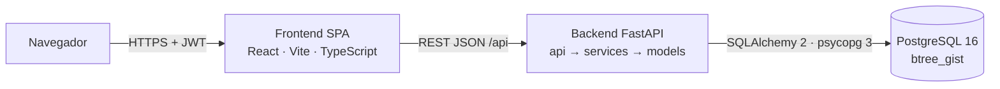
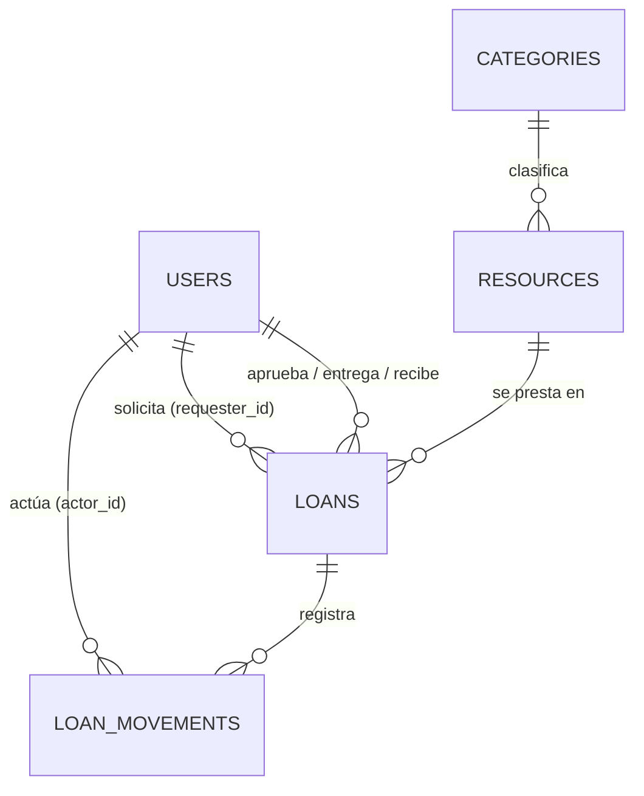
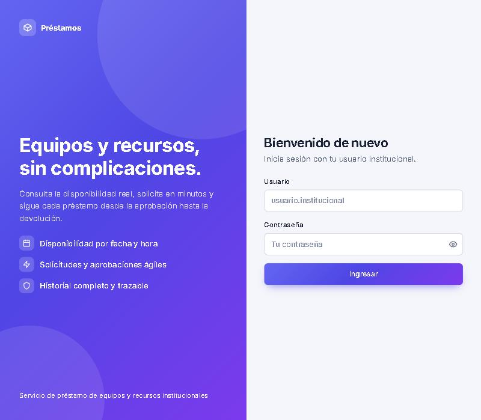
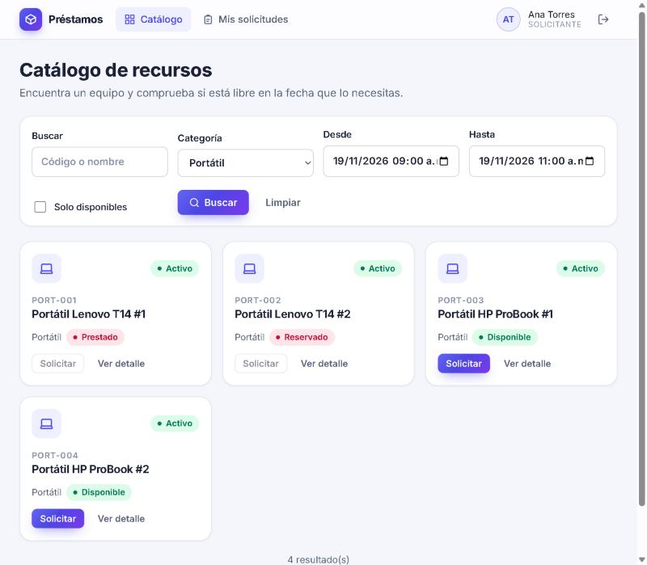
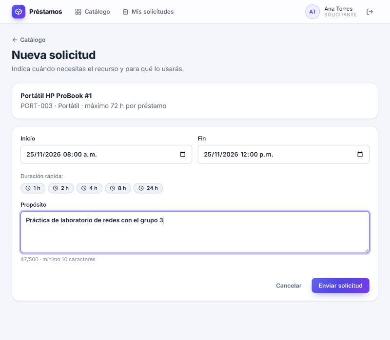
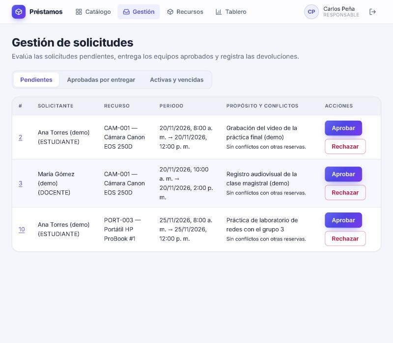
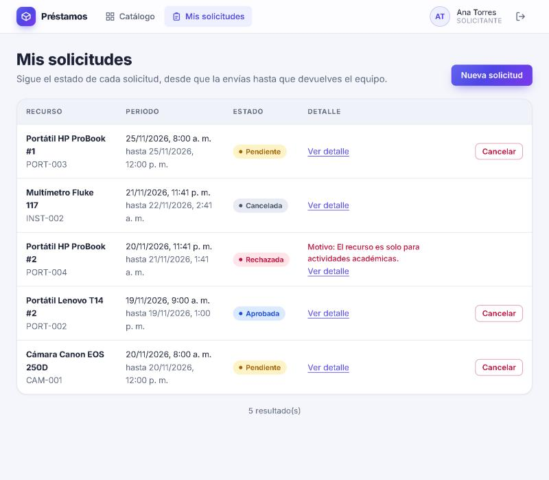
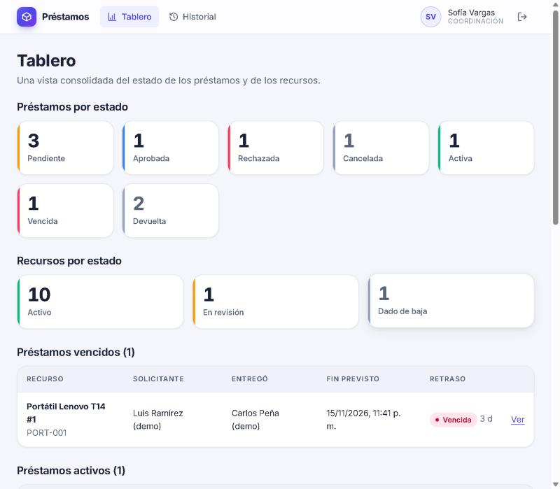

# Gestión de préstamos de equipos y recursos

Aplicación web cliente-servidor para gestionar el ciclo completo de préstamo de equipos y recursos de una
institución educativa: **consulta de disponibilidad → solicitud → evaluación → entrega → devolución → historial
y tablero de coordinación**. Proyecto final PF-03.

## 1. Información general

| | |
|---|---|
| **Proyecto** | Gestión de préstamos de equipos y recursos (PF-03) |
| **Asignatura** | Aplicaciones y Servicios Web — Tecnología en Desarrollo de Software |
| **Docente** | Juan Carlos Morales Guerra |
| **Fecha** | Noviembre de 2026 |
| **Repositorio** | https://github.com/SantiagoSo2425/prestamos-equipos-recursos |
| **Aplicación desplegada** | https://salmon-meadow-079001f10.6.azurestaticapps.net (API: https://app-prestamos-80585.azurewebsites.net/docs) |

| Integrante | Usuario de GitHub | Contribución principal |
|---|---|---|
| Santiago | [@SantiagoSo2425](https://github.com/SantiagoSo2425) | Autenticación y base del backend; catálogo y disponibilidad; solicitudes; administración de recursos; tablero e historial; frontend de esas historias; rediseño de la interfaz; Docker, Azure y CD; documentación de requisitos, diseño y pruebas PF-01…04, 11–14 |
| Juan Carlos Monsalve Restrepo | [@JuanMR1017](https://github.com/JuanMR1017) | Modelo de datos, migración y semilla; reglas de negocio y concurrencia; evaluación, entrega y devolución; layout y componentes compartidos; pruebas automatizadas y CI; pruebas PF-05…10 |

El reparto por tareas está en [`specs/001-prestamos-equipos/tasks.md`](specs/001-prestamos-equipos/tasks.md) y los
aportes verificables en la sección [8](#8-control-de-versiones).

## 2. Descripción del sistema

**Problema.** Las solicitudes y entregas de portátiles, cámaras, instrumentos y otros recursos se gestionan con
formularios y hojas de cálculo independientes: no se sabe con certeza qué está disponible, quién lo tiene ni cuándo
debe devolverlo, y hay solicitudes simultáneas sobre un mismo recurso.

**Actores y permisos**

| Actor | Rol en el sistema | Puede |
|---|---|---|
| Solicitante (estudiante o docente) | `SOLICITANTE` | Consultar el catálogo, registrar y cancelar **sus** solicitudes y ver su historial |
| Responsable de préstamos | `RESPONSABLE` | Administrar recursos, aprobar/rechazar, registrar entregas y devoluciones |
| Coordinación | `COORDINACION` | Consulta de solo lectura: tablero e historial consolidados |

**Reglas principales** (siempre validadas en el servidor)

- Una solicitud no puede solaparse con otra aprobada o con un préstamo activo del mismo recurso; los periodos
  contiguos (uno termina cuando el otro empieza) no se consideran solapados.
- Un estudiante puede tener como máximo 2 préstamos aprobados o activos; un docente, 5.
- Quien tenga un préstamo **vencido** (activo con fecha de fin superada) no puede hacer nuevas solicitudes, y ese
  préstamo ocupa el recurso hasta su devolución.
- Los recursos «solo docentes» no se prestan a estudiantes; la duración máxima depende de la categoría.
- Devolver con daño pasa el recurso a *en revisión*. Cada cambio de estado queda en un historial inmutable.

**Fuera de alcance** (según la guía): QR/RFID, notificaciones por correo o WhatsApp, sanciones económicas,
integración con inventarios externos, compras y mantenimiento físico.

Requisitos completos en [`docs/requisitos.md`](docs/requisitos.md).

## 3. Requisitos y alcance

**Método.** El alcance se delimitó a partir del enunciado y las condiciones de aceptación CA-01…CA-06 de la guía,
con desarrollo guiado por especificación: [`spec.md`](specs/001-prestamos-equipos/spec.md) (historias de usuario con
escenarios *Given/When/Then* y 38 requisitos funcionales), [`plan.md`](specs/001-prestamos-equipos/plan.md),
[`data-model.md`](specs/001-prestamos-equipos/data-model.md) y el contrato de API acordado entre los dos
integrantes antes de dividir el trabajo.

**Entrevista y decisiones confirmadas.** El registro de la entrevista con el docente (preguntas, respuestas,
acuerdos y pendientes) debe ir en [`docs/requisitos.md`](docs/requisitos.md#1-registro-de-entrevista). **Aún no
está registrado:** hoy el documento contiene las preguntas previstas y los supuestos de trabajo, marcados como
*sin confirmar* (duración máxima por categoría 72/48/24/72 h y límites de 2 y 5 préstamos simultáneos).

**Requisitos priorizados** (detalle RF-01…RF-38 y RNF-01…RNF-07 en `docs/requisitos.md`)

| Prioridad | Historia | Criterio | Requisitos |
|---|---|---|---|
| P1 | US1 Consultar catálogo y disponibilidad | CA-01 | RF-05…RF-08 |
| P1 | US2 Registrar solicitud | CA-02 | RF-09…RF-17 |
| P1 | US3 Evaluar solicitudes | CA-03 | RF-18…RF-21 |
| P1 | US4 Entrega y préstamo activo | CA-04 | RF-22…RF-25 |
| P1 | US5 Devolución e historial | CA-05 | RF-26…RF-30 |
| P2 | US6 Tablero de coordinación | CA-06 | RF-31…RF-33 |
| P2 | US7 Administración de recursos | — | RF-34…RF-36 |
| Transversal | Autenticación, permisos y validación | — | RF-01…RF-04, RF-37, RF-38 |

## 4. Arquitectura, diseño de API y modelo de datos



- **Frontend** (`frontend/src`): rutas protegidas por rol, TanStack Query para datos y un cliente HTTP único.
- **Backend** (`backend/app`): capas `api/` (HTTP y validación), `services/` (reglas de negocio), `domain/`
  (máquina de estados) y `models/`.
- **Base de datos**: PostgreSQL con migraciones Alembic y una restricción de exclusión de rangos
  (`loans_no_overlap`) que impide dos reservas solapadas aunque falle la lógica de la aplicación.

**Modelo de datos**



**Estados de un préstamo:** `PENDIENTE → APROBADA → ACTIVA → DEVUELTA`, con salidas `RECHAZADA` y `CANCELADA`;
«vencida» no se almacena, se calcula (activa con fecha de fin pasada).

**Interfaz** (capturas del sistema en ejecución; detalle de pantallas y rutas en `docs/diseno.md`)

| | |
|---|---|
|  |  |
| Inicio de sesión | Catálogo en tarjetas, con filtros por categoría y rango de fechas |
|  |  |
| Nueva solicitud con validación | Bandeja de gestión del responsable |
|  |  |
| Mis solicitudes y su estado | Tablero consolidado de coordinación |

**Tecnologías y justificación**

| Tecnología | Motivo |
|---|---|
| FastAPI + Pydantic v2 | Validación declarativa, errores consistentes y OpenAPI automática (`/docs`) |
| SQLAlchemy 2 + Alembic | Modelo y migraciones versionadas; transacciones explícitas |
| PostgreSQL 16 + `btree_gist` | Restricción de exclusión de rangos: garantiza que no haya asignaciones incompatibles ni con concurrencia |
| JWT + bcrypt | Sesión sin estado y contraseñas almacenadas con hash |
| React + Vite + TypeScript | Tipos del contrato de la API de extremo a extremo |
| TanStack Query | Caché e invalidación de consultas tras cada operación |

Diagramas completos, máquina de estados, reglas V1–V7, matriz de permisos y correspondencia con los requisitos en
[`docs/diseno.md`](docs/diseno.md). Para exponerlo: organización del repositorio, modelo de datos, usuarios y ciclos de vida en [`docs/explicacion-sistema.md`](docs/explicacion-sistema.md).

## 5. Configuración del entorno

Requisitos: Python 3.12, Node.js ≥ 20 y PostgreSQL 16 (o Docker).

**Opción A — con Docker** (PostgreSQL y backend)

```bash
docker compose up --build -d          # API en http://127.0.0.1:8090 (puerto configurable con API_PORT)
docker compose run --rm -e SEED_PASSWORD='<clave-de-demo>' --entrypoint "" backend python -m app.seed
cd frontend && npm install && npm run dev   # con VITE_API_URL=http://localhost:8090/api en frontend/.env
```

**Opción B — instalación local**

```powershell
# Backend
cd backend
py -3.12 -m venv .venv
.\.venv\Scripts\python -m pip install -r requirements.txt
Copy-Item .env.example .env          # completar DATABASE_URL, JWT_SECRET y SEED_PASSWORD locales
.\.venv\Scripts\python -m alembic upgrade head
.\.venv\Scripts\python -m app.seed
.\.venv\Scripts\python -m uvicorn app.main:app --reload --port 8000

# Frontend (otra terminal)
cd frontend
npm install
Copy-Item .env.example .env          # VITE_API_URL=http://localhost:8000/api
npm run dev
```

**Variables de entorno** (`backend/.env.example`, sin secretos): `DATABASE_URL`, `JWT_SECRET`,
`JWT_EXPIRE_MINUTES`, `CORS_ORIGINS`, `SEED_PASSWORD`, `TZ_NAME`. El archivo `.env` nunca se versiona.

**Datos de prueba (ficticios).** `python -m app.seed` crea categorías, 12 recursos y préstamos en todos los
estados, y estos usuarios con la contraseña definida en `SEED_PASSWORD`:

| Usuario | Rol | Nota |
|---|---|---|
| `est.ana` | SOLICITANTE (estudiante) | Sin préstamos vencidos |
| `est.luis` | SOLICITANTE (estudiante) | Tiene un préstamo vencido: no puede solicitar |
| `doc.maria` | SOLICITANTE (docente) | Puede pedir recursos «solo docentes» |
| `resp.carlos` | RESPONSABLE | Evalúa, entrega y recibe |
| `coord.sofia` | COORDINACION | Solo lectura |

La API queda en `/docs` (Swagger). Pasos de validación de extremo a extremo en
[`quickstart.md`](specs/001-prestamos-equipos/quickstart.md).

**Despliegue.** El sistema está desplegado en Azure (App Service con contenedor desde Container Registry,
Static Web Apps y PostgreSQL) con despliegue continuo desde `main`; ver [`docs/despliegue.md`](docs/despliegue.md) y
[`docs/integracion-continua.md`](docs/integracion-continua.md). Ni Docker ni el despliegue en la nube son requisito
de la guía.

## 6. Servicios web implementados

Contrato completo en [`contracts/api.md`](specs/001-prestamos-equipos/contracts/api.md); tabla contrastada con el
OpenAPI generado por la aplicación. Además existe `GET /api/health`.

| Método | Ruta | Roles | Descripción | Requisitos |
|---|---|---|---|---|
| POST | `/api/auth/login` | público | Inicia sesión y devuelve el JWT | RF-01 |
| GET | `/api/auth/me` | todos | Usuario autenticado | RF-02 |
| GET | `/api/categories` | todos | Categorías y duración máxima | RF-05 |
| GET | `/api/resources` | todos | Catálogo con disponibilidad y filtros | RF-05…RF-07 |
| GET | `/api/resources/{id}` | todos | Detalle y periodos ocupados | RF-08 |
| POST | `/api/resources` | RESPONSABLE | Registrar recurso | RF-34 |
| PATCH | `/api/resources/{id}` | RESPONSABLE | Editar datos o estado operativo | RF-34, RF-35 |
| POST | `/api/loans` | SOLICITANTE | Registrar solicitud | RF-09…RF-16 |
| GET | `/api/loans` | todos (solicitante: solo propias) | Listar y filtrar solicitudes e historial | RF-16, RF-30, RF-32 |
| GET | `/api/loans/{id}` | dueño, R, C | Detalle de la operación | RF-16, RF-25 |
| POST | `/api/loans/{id}/cancel` | SOLICITANTE dueño | Cancelar solicitud | RF-17 |
| GET | `/api/loans/{id}/movements` | dueño, R, C | Historial de movimientos | RF-29, RF-30 |
| POST | `/api/loans/{id}/approve` | RESPONSABLE | Aprobar (revalida con bloqueo) | RF-18, RF-20, RF-21 |
| POST | `/api/loans/{id}/reject` | RESPONSABLE | Rechazar con motivo | RF-19 |
| POST | `/api/loans/{id}/deliver` | RESPONSABLE | Registrar entrega → activa | RF-22…RF-25 |
| POST | `/api/loans/{id}/return` | RESPONSABLE | Registrar devolución | RF-26…RF-28 |
| GET | `/api/dashboard/summary` | RESPONSABLE, COORDINACION | Totales y préstamos activos/vencidos | RF-31 |
| GET | `/api/dashboard/usage` | RESPONSABLE, COORDINACION | Uso por categoría y recurso | RF-31, RF-32 |

Todas las rutas salvo el login exigen `Authorization: Bearer <jwt>`.

**Ejemplos** (abreviados)

```http
POST /api/auth/login
{ "username": "est.ana", "password": "<SEED_PASSWORD>" }
→ 200 { "access_token": "<jwt>", "token_type": "bearer", "expires_in": 3600,
        "user": { "id": 1, "username": "est.ana", "role": "SOLICITANTE", "requester_type": "ESTUDIANTE", ... } }
```

```http
POST /api/loans            (token de est.ana)
{ "resource_id": 2, "start_at": "2026-11-25T08:00:00-05:00",
  "end_at": "2026-11-25T12:00:00-05:00", "purpose": "Práctica de laboratorio de redes" }
→ 201 { "id": 10, "status": "PENDIENTE", "effective_status": "PENDIENTE",
        "resource": { "code": "PORT-002", ... }, "requester": { "username": "est.ana", ... }, ... }
```

**Errores y validaciones.** Todos los errores tienen el formato `{ "detail", "code", "fields"? }`, sin trazas.

| HTTP | `code` | Cuándo |
|---|---|---|
| 401 | `NOT_AUTHENTICATED`, `INVALID_CREDENTIALS`, `TOKEN_EXPIRED` | Sin token, login fallido o token vencido |
| 403 | `FORBIDDEN`, `TEACHER_ONLY` | Rol no permitido; estudiante sobre un recurso solo docentes |
| 404 | `NOT_FOUND` | Id inexistente, o ajeno para un solicitante (no revela su existencia) |
| 409 | `OVERLAP`, `LIMIT_REACHED`, `OVERDUE_BLOCK`, `INVALID_TRANSITION`, `RESOURCE_NOT_AVAILABLE`, `DUPLICATE_CODE`, `RESOURCE_IN_USE`, `START_PASSED` | Reglas de negocio |
| 422 | `VALIDATION_ERROR` | Datos inválidos, con `fields[{field, message}]` en español |
| 500 | `INTERNAL_ERROR` | Mensaje genérico |

```json
{ "detail": "Datos inválidos.", "code": "VALIDATION_ERROR",
  "fields": [{ "field": "end_at", "message": "Debe ser posterior a la fecha de inicio." }] }
```

Documentación interactiva: `/docs` en local y https://app-prestamos-80585.azurewebsites.net/docs en Azure.

## 7. Pruebas de API e integración y evidencias

Pruebas funcionales documentadas, todas ejecutadas contra PostgreSQL con la semilla. Resultado y evidencia de cada
una en [`docs/pruebas.md`](docs/pruebas.md) y `docs/pruebas/`.

| ID | Prueba | Criterio | Estado | Documento |
|---|---|---|---|---|
| PF-01 | Consulta del catálogo y disponibilidad | CA-01 | ✅ Aprobada | [PF-01](docs/pruebas/PF-01.md) |
| PF-02 | Consulta de recurso inexistente → 404 | CA-01 | ✅ Aprobada | [PF-02](docs/pruebas/PF-02.md) |
| PF-03 | Registro de solicitud válida | CA-02 | ✅ Aprobada | [PF-03](docs/pruebas/PF-03.md) |
| PF-04 | Solicitudes con datos inválidos o reglas incumplidas | CA-02 | ✅ Aprobada | [PF-04](docs/pruebas/PF-04.md) |
| PF-05 | Aprobación y rechazo por personal autorizado | CA-03 | ✅ Aprobada | [PF-05…10](docs/pruebas/PF-05-a-PF-10.md) |
| PF-06 | Gestión por un actor no autorizado → 403 | CA-03 | ✅ Aprobada | [PF-05…10](docs/pruebas/PF-05-a-PF-10.md) |
| PF-07 | Asignación de un recurso disponible | CA-04 | ✅ Aprobada | [PF-05…10](docs/pruebas/PF-05-a-PF-10.md) |
| PF-08 | Asignación incompatible → 409, disponibilidad conservada | CA-04 | ✅ Aprobada | [PF-05…10](docs/pruebas/PF-05-a-PF-10.md) |
| PF-09 | Consulta de préstamo activo y vencido | CA-04 | ✅ Aprobada | [PF-05…10](docs/pruebas/PF-05-a-PF-10.md) |
| PF-10 | Devolución e historial | CA-05 | ✅ Aprobada | [PF-05…10](docs/pruebas/PF-05-a-PF-10.md) |
| PF-11 | Información consolidada y consistencia | CA-06 | ✅ Aprobada | [PF-11](docs/pruebas/PF-11.md) |
| PF-12 | Flujo integral interfaz–API–BD | CA-01…06 | ✅ Aprobada | [PF-12](docs/pruebas/PF-12.md) |
| PF-13 | Alta de recurso y código duplicado (adicional) | US7 | ✅ Aprobada | [PF-13](docs/pruebas/PF-13.md) |
| PF-14 | Cambio de estado con préstamo activo (adicional) | US7 | ✅ Aprobada | [PF-14](docs/pruebas/PF-14.md) |

**Cómo reproducirlas** (con la base migrada y sembrada, y las variables de `backend/.env`):

```bash
cd backend
python -m scripts.verify_a                       # PF-01…04, 11, 13, 14 y el ciclo completo por API
python -m scripts.smoke_flow                     # PF-05…10
python -m pytest                                 # reglas V1–V7, concurrencia, permisos y flujo (suite automatizada)
```

Las peticiones HTTP están en [`docs/pruebas/prestamos.http`](docs/pruebas/prestamos.http) (extensión REST Client) y
también se pueden ejecutar desde `/docs`. `verify_a` y `smoke_flow` modifican datos: ejecútalos sobre una base
recién sembrada.

**Evidencias** (carpeta [`evidencias/`](evidencias)): salida de los scripts
([`PF-A`](evidencias/PF-A/salida-verify-a.txt), [`PF-05-a-PF-10`](evidencias/PF-05-a-PF-10/salida-smoke.txt)),
el flujo completo con las consultas SQL ([`PF-12`](evidencias/PF-12/salida-sql.txt)), capturas de interfaz
([`interfaz/`](evidencias/interfaz), `PF-01`, `PF-03`, `PF-12`) y el rendimiento con 200+ recursos y 2.000+
operaciones ([`SC-008`](evidencias/SC-008-rendimiento.txt)). El CI ejecuta la suite automatizada en cada cambio.

Matriz criterio → requisito → implementación → PR → prueba en [`docs/trazabilidad.md`](docs/trazabilidad.md). Guion para la defensa en [`docs/guion-sustentacion.md`](docs/guion-sustentacion.md).

## 8. Control de versiones

- **Repositorio:** https://github.com/SantiagoSo2425/prestamos-equipos-recursos
- **Flujo:** ramas por unidad de trabajo (`feat/…`, `feature/…`, `docs/…`) integradas a `develop` por pull request;
  `main` está protegida (PR obligatorio, 1 aprobación y CI en verde) y solo ella despliega a Azure. Commits en español,
  con estilo *Conventional Commits* y referencia al requisito.

| PR | Autor | Contenido |
|---|---|---|
| [#1](https://github.com/SantiagoSo2425/prestamos-equipos-recursos/pull/1) | Santiago | Especificación, plan, contrato de API y tareas |
| [#2](https://github.com/SantiagoSo2425/prestamos-equipos-recursos/pull/2) | Santiago | Esqueleto del backend, autenticación y lectura de préstamos |
| [#3](https://github.com/SantiagoSo2425/prestamos-equipos-recursos/pull/3) | Santiago | Catálogo, solicitudes, administración de recursos y tablero |
| [#4](https://github.com/SantiagoSo2425/prestamos-equipos-recursos/pull/4) | Juan | Base de datos, reglas y flujo aprobar/entregar/devolver |
| [#5](https://github.com/SantiagoSo2425/prestamos-equipos-recursos/pull/5) | Santiago | Verificación en PostgreSQL, PF-12, requisitos y diseño |
| [#6](https://github.com/SantiagoSo2425/prestamos-equipos-recursos/pull/6) | Juan | Pruebas automatizadas y GitHub Actions |
| [#7](https://github.com/SantiagoSo2425/prestamos-equipos-recursos/pull/7) | Santiago | Despliegue en Azure con contenedores |
| [#8](https://github.com/SantiagoSo2425/prestamos-equipos-recursos/pull/8) | Santiago | Rediseño de la interfaz |
| [#9](https://github.com/SantiagoSo2425/prestamos-equipos-recursos/pull/9) | Santiago | Release a `main` (**aprobado por @JuanMR1017**) |
| [#10](https://github.com/SantiagoSo2425/prestamos-equipos-recursos/pull/10) | Santiago | Documentación del subject OIDC |

**Aportes verificables por integrante** (`git log --author=…`, `git shortlog -sn`):

- **Santiago:** ramas `feat/Santiago`, `feat/ui-redesign`, `feat/cd-azure`, `docs/…`; autenticación, catálogo, solicitudes,
  recursos, tablero, Docker, CD en Azure, rediseño de la interfaz y documentos de requisitos, diseño y pruebas.
- **Juan:** rama `feature/JuanCarlos`; modelos, migración y semilla, reglas y concurrencia (`rules.py`,
  `loan_workflow.py`), pantallas de gestión y detalle, plantilla de PR, pruebas automatizadas y CI.

## 9. Conclusiones y limitaciones

**Cumplimiento de las condiciones.**

| Condición | Estado | Demostración |
|---|---|---|
| CA-01 Consulta y disponibilidad | ✅ | PF-01, PF-02 |
| CA-02 Registro de solicitud | ✅ | PF-03, PF-04 |
| CA-03 Evaluación y gestión | ✅ | PF-05, PF-06 |
| CA-04 Asignación y entrega sin incompatibilidades | ✅ | PF-07, PF-08, PF-09 |
| CA-05 Devolución e historial | ✅ | PF-10 |
| CA-06 Información consolidada para coordinación | ✅ | PF-11 |

El ciclo completo funciona de extremo a extremo (PF-12), con reglas aplicadas en el servidor y respaldadas por la
base de datos, y cumple el objetivo de rendimiento (consultas en menos de 2 s con 200+ recursos y 2.000+ operaciones).

**Dificultades técnicas y soluciones**

| Dificultad | Solución |
|---|---|
| Dos aprobaciones simultáneas del mismo recurso podían dejar solapes | Bloqueo `SELECT … FOR UPDATE` de recurso y solicitante y restricción de exclusión `EXCLUDE USING gist` en PostgreSQL; prueba de aprobación concurrente (solo una gana) |
| Un préstamo vencido sin devolver debía seguir ocupando el recurso | La ocupación de un préstamo activo vencido se trata como abierta (`[inicio, +∞)`) en las consultas de disponibilidad |
| Cancelar con rol no permitido respondía 404 en vez de 403 | La matriz rol × endpoint (`test_permissions.py`) lo detectó; ahora el rol se valida antes que la existencia |
| El historial de un préstamo no se actualizaba tras entregar o devolver | La consulta del historial usa el prefijo de clave `['loan', id]`, que ya invalidan las acciones |
| Los diálogos no cubrían toda la pantalla | Una animación con `fill-mode: both` dejaba un `transform` activo que atrapaba los elementos `fixed`; se cambió a `backwards` |
| PostgreSQL devolvía `SkuNotAvailable` en Central US pese a mostrarse disponible | Se creó el servidor en Mexico Central, manteniendo el resto en Central US |
| El primer despliegue falló con `AADSTS700213` | GitHub firma el token OIDC con IDs inmutables en el *subject*; se añadió la credencial federada con ese formato (ver `docs/despliegue.md`) |

**Limitaciones y pendientes**

- La entrevista con el docente no está registrada y los supuestos de negocio (duraciones por categoría y límites
  2/5) siguen sin confirmar; el alcance no consta como aprobado por el docente.
- No hay gestión de usuarios desde la interfaz (se cargan con la semilla), recuperación de contraseña ni
  notificaciones.
- El estado «vencido» se calcula al consultar: no hay procesos programados ni avisos automáticos.
- Una solicitud corresponde a una sola unidad de recurso.
- Despliegue de una sola instancia y un único ambiente: las migraciones se aplican al arrancar el backend.
