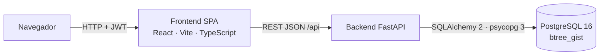
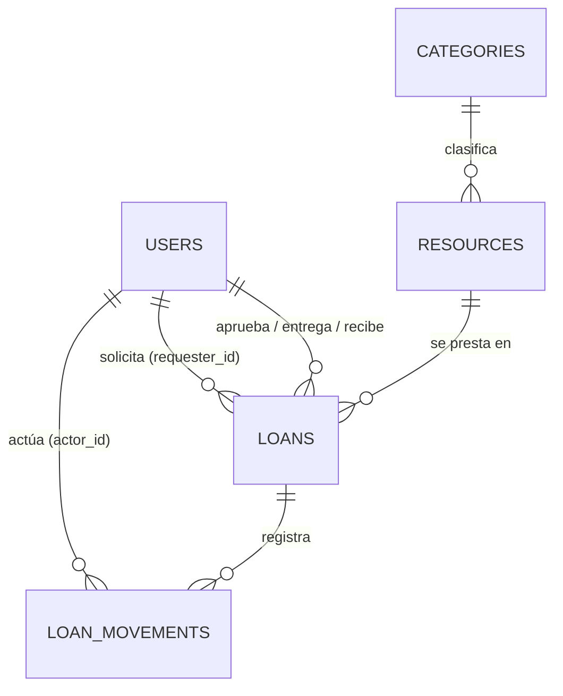
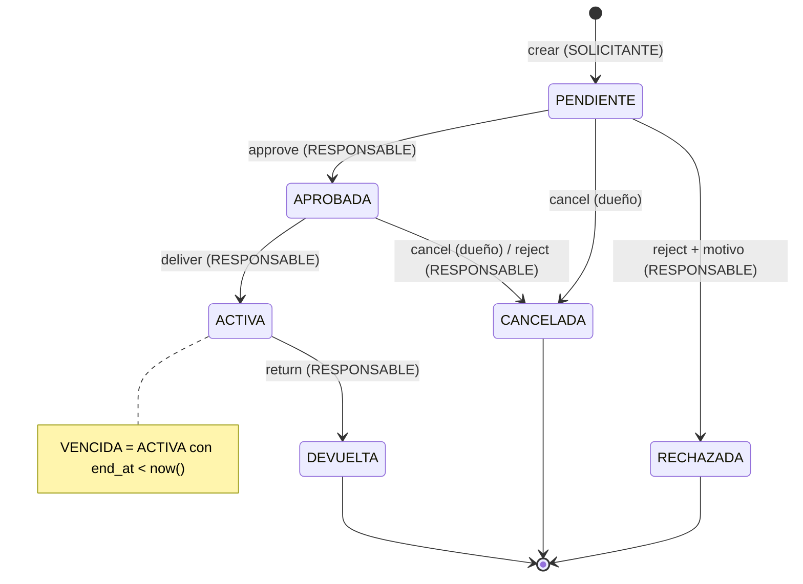

# Diseño técnico

Documento de diseño del sistema de préstamos de equipos y recursos. Complementa la especificación
([`spec.md`](../specs/001-prestamos-equipos/spec.md)), el plan
([`plan.md`](../specs/001-prestamos-equipos/plan.md)) y el contrato de API
([`contracts/api.md`](../specs/001-prestamos-equipos/contracts/api.md)). El detalle de requisitos está en
[`requisitos.md`](requisitos.md).

> Explicación guiada del repositorio, la base de datos, los usuarios y los ciclos de vida: [`explicacion-sistema.md`](explicacion-sistema.md).

## 1. Arquitectura de componentes



- **Frontend** (`frontend/src`): SPA con React Router (rutas protegidas por rol), TanStack Query
  (caché y reintentos de consultas) y un cliente `apiFetch` que adjunta el JWT y normaliza los errores.
- **Backend** (`backend/app`): API REST bajo `/api`, documentación OpenAPI viva en `/docs`.
- **Base de datos**: PostgreSQL 16; la migración inicial (Alembic) crea tablas, enumeraciones,
  restricciones `CHECK` y la restricción de exclusión `loans_no_overlap`.

## 2. Capas del backend

| Capa | Carpeta | Responsabilidad |
|---|---|---|
| API | `api/` | Rutas HTTP, validación de entrada (Pydantic) y dependencias de seguridad (`get_current_user`, `require_roles`) |
| Servicios | `services/` | Reglas de negocio y casos de uso: `rules` (V1–V7), `loans`, `loan_workflow`, `resources`, `dashboard`, `movements` |
| Dominio | `domain/loan_states.py` | Tabla de transiciones permitidas por estado, acción y rol |
| Modelos | `models/` | Entidades SQLAlchemy y enumeraciones |
| Transversal | `config.py`, `errors.py`, `security.py`, `database.py` | Configuración (`.env`), errores uniformes, JWT/bcrypt y sesión de BD por petición |

Las reglas se aplican siempre en el servidor; la interfaz solo las anticipa para dar mejor
retroalimentación. Cada petición usa una sesión de BD que hace *commit* si termina bien y *rollback* ante
cualquier excepción, de modo que una operación rechazada no deja datos a medias.

## 3. Modelo de datos



Detalle de columnas, tipos y restricciones en [`data-model.md`](../specs/001-prestamos-equipos/data-model.md).
Puntos clave:

- Valores de enumeraciones en español (coinciden con la UI); fechas `timestamptz` en UTC y mostradas en
  `America/Bogota`.
- Un único registro `loans` recorre todo el ciclo (solicitud → préstamo); `VENCIDA` no se almacena, se
  calcula como `ACTIVA` con `end_at < now()`.
- `loan_movements` es de solo inserción: cada cambio de estado deja actor, fecha, estado anterior y nuevo.
- Sin borrado físico de recursos ni préstamos.

## 4. Máquina de estados



| Acción | Desde | Hacia | Rol | Reglas adicionales |
|---|---|---|---|---|
| `create` | — | PENDIENTE | SOLICITANTE | V1–V7 |
| `approve` | PENDIENTE | APROBADA | RESPONSABLE | `start_at > now()`, V3–V7 revalidadas con bloqueo |
| `reject` | PENDIENTE, APROBADA | RECHAZADA | RESPONSABLE | motivo 5–500 caracteres |
| `cancel` | PENDIENTE, APROBADA | CANCELADA | SOLICITANTE dueño | — |
| `deliver` | APROBADA | ACTIVA | RESPONSABLE | recurso ACTIVO, sin otro ACTIVA del recurso |
| `return` | ACTIVA (incl. VENCIDA) | DEVUELTA | RESPONSABLE | `CON_DANO` ⇒ notas y recurso → EN_REVISION |

Cualquier otra combinación responde `409 INVALID_TRANSITION`; un rol no permitido responde `403 FORBIDDEN`.

## 5. Reglas de validación y concurrencia

| ID | Regla | Error |
|---|---|---|
| V1 | `start_at >= now()`, `end_at > start_at`, propósito 10–500 | 422 `VALIDATION_ERROR` |
| V2 | `end_at - start_at <= category.max_loan_hours` | 422 `VALIDATION_ERROR` |
| V3 | recurso existe y `status = ACTIVO` | 404 / 409 `RESOURCE_NOT_AVAILABLE` |
| V4 | `teacher_only` ⇒ solicitante DOCENTE | 403 `TEACHER_ONLY` |
| V5 | solicitante sin préstamos VENCIDOS | 409 `OVERDUE_BLOCK` |
| V6 | APROBADAS + ACTIVAS del solicitante < límite (ESTUDIANTE 2, DOCENTE 5) | 409 `LIMIT_REACHED` |
| V7 | sin solape con APROBADA/ACTIVA del recurso (ACTIVA vencida ocupa `[start, +∞)`) | 409 `OVERLAP` |

La incompatibilidad de asignaciones se garantiza en dos niveles:

1. **Servicio**: `lock_resource` y `lock_user` (`SELECT … FOR UPDATE`) serializan las decisiones
   concurrentes y `check_can_request` revalida V3–V7 al aprobar.
2. **Base de datos**: la restricción `EXCLUDE USING gist (resource_id WITH =, tstzrange(start_at, end_at, '[)') WITH &&)
   WHERE (status IN ('APROBADA','ACTIVA'))` impide dos reservas solapadas aunque falle la lógica de aplicación;
   un conflicto se traduce a `409 OVERLAP`. Los periodos contiguos no se consideran solapados (rango `[)`).

Una `ACTIVA` vencida ocupa el recurso hasta su devolución (`[start_at, +∞)`).

## 6. Especificación de la API

Base `http://localhost:8000/api`; documentación interactiva en `http://localhost:8000/docs`. Todas las
rutas, salvo `/auth/login`, exigen `Authorization: Bearer <jwt>`.

| # | Método | Ruta | Roles | Descripción | Req. | Dueño |
|---|---|---|---|---|---|---|
| 1 | POST | `/auth/login` | público | Inicia sesión, devuelve JWT | FR-001 | A |
| 2 | GET | `/auth/me` | S R C | Usuario autenticado | FR-002 | A |
| 3 | GET | `/categories` | S R C | Lista categorías y duración máxima | FR-005 | A |
| 4 | GET | `/resources` | S R C | Catálogo con disponibilidad y filtros | FR-005–007 | A |
| 5 | GET | `/resources/{id}` | S R C | Detalle + periodos ocupados | FR-008 | A |
| 6 | POST | `/resources` | R | Registrar recurso | FR-034 | A |
| 7 | PATCH | `/resources/{id}` | R | Editar datos / estado operativo | FR-034–035 | A |
| 8 | POST | `/loans` | S | Registrar solicitud | FR-009–016 | A |
| 9 | GET | `/loans` | S(propias) R C | Listar/filtrar solicitudes e historial | FR-016, FR-030, FR-032 | A |
| 10 | GET | `/loans/{id}` | S(dueño) R C | Detalle de la operación | FR-016, FR-025 | A |
| 11 | POST | `/loans/{id}/cancel` | S(dueño) | Cancelar | FR-017 | A |
| 12 | POST | `/loans/{id}/approve` | R | Aprobar | FR-018, FR-020–021 | B |
| 13 | POST | `/loans/{id}/reject` | R | Rechazar con motivo | FR-019 | B |
| 14 | POST | `/loans/{id}/deliver` | R | Registrar entrega → ACTIVA | FR-022–025 | B |
| 15 | POST | `/loans/{id}/return` | R | Registrar devolución → DEVUELTA | FR-026–028 | B |
| 16 | GET | `/loans/{id}/movements` | S(dueño) R C | Historial de movimientos | FR-029–030 | B |
| 17 | GET | `/dashboard/summary` | R C | Totales y préstamos activos/vencidos | FR-031 | A |
| 18 | GET | `/dashboard/usage` | R C | Uso por recurso y categoría en rango | FR-031–032 | A |

### Formato de errores

```json
{ "detail": "El recurso ya está reservado en ese periodo.", "code": "OVERLAP" }
```

```json
{ "detail": "Datos inválidos.", "code": "VALIDATION_ERROR",
  "fields": [{ "field": "end_at", "message": "Debe ser posterior a la fecha de inicio." }] }
```

Códigos: `401` (`NOT_AUTHENTICATED`, `INVALID_CREDENTIALS`, `TOKEN_EXPIRED`), `403` (`FORBIDDEN`,
`TEACHER_ONLY`), `404` (`NOT_FOUND`), `409` (`OVERLAP`, `LIMIT_REACHED`, `OVERDUE_BLOCK`,
`INVALID_TRANSITION`, `RESOURCE_NOT_AVAILABLE`, `DUPLICATE_CODE`, `RESOURCE_IN_USE`, `START_PASSED`),
`422` (`VALIDATION_ERROR`) y `500` (`INTERNAL_ERROR`, sin trazas). Ejemplos de petición y respuesta de cada
endpoint en [`contracts/api.md`](../specs/001-prestamos-equipos/contracts/api.md) y reproducibles en
[`docs/pruebas/prestamos.http`](pruebas/prestamos.http).

## 7. Autenticación, permisos y seguridad

- Contraseñas con hash bcrypt; sesión mediante JWT (HS256) con expiración configurable.
- `require_roles(...)` protege cada endpoint por rol; los SOLICITANTE solo acceden a sus propias
  operaciones (el acceso a una ajena responde `404` para no revelar su existencia).
- El login responde con el mismo mensaje para usuario inexistente o clave incorrecta.
- Los errores no controlados responden `500` genérico; la traza se registra solo en el servidor.
- Secretos solo en `.env` (ignorado por Git); `.env.example` no contiene valores reales.
- La matriz rol × endpoint se comprueba con `backend/tests/test_permissions.py`.

| Endpoint | SOLICITANTE | RESPONSABLE | COORDINACION |
|---|---|---|---|
| Catálogo, detalle, categorías | ✅ | ✅ | ✅ |
| Crear / editar recursos | ❌ | ✅ | ❌ |
| Crear y listar usuarios | ❌ | ✅ | ❌ |
| Crear solicitud, cancelar | ✅ (dueño) | ❌ | ❌ |
| Listar / ver préstamos e historial | ✅ (solo propios) | ✅ | ✅ |
| Aprobar, rechazar, entregar, devolver | ❌ | ✅ | ❌ |
| Tablero y uso | ❌ | ✅ | ✅ |

## 8. Interfaz

Rutas del frontend y su rol:

| Ruta | Pantalla | Roles |
|---|---|---|
| `/login` | Inicio de sesión | público |
| `/catalogo`, `/catalogo/:id` | Catálogo con filtros y detalle con periodos ocupados | S, R, C |
| `/solicitudes/nueva` | Nueva solicitud (validación en cliente y servidor) | S |
| `/mis-solicitudes` | Solicitudes propias, motivo de rechazo y cancelación | S |
| `/gestion` | Bandeja de evaluación: pendientes, por entregar, activas y vencidas | R |
| `/prestamos/:id` | Detalle, historial de movimientos y acciones (aprobar, rechazar, entregar, devolver) | S, R, C |
| Modal «Nuevo recurso» / «Editar» en `/catalogo` y `/catalogo/:id` | Alta y edición de recursos (ventana modal, sin pantalla propia) | R |
| `/tablero`, `/historial` | Totales, vencidos, uso e historial filtrable | R, C (historial) |

Capturas de las pantallas en `evidencias/` (p. ej. `PF-01/catalogo-est-ana.jpg`,
`PF-03/mis-solicitudes-pendiente.jpg`, `PF-12/historial-4-movimientos.jpg`).

## 9. Justificación de tecnologías

| Tecnología | Motivo |
|---|---|
| FastAPI + Pydantic v2 | Validación declarativa, errores consistentes y OpenAPI automática |
| SQLAlchemy 2 + Alembic | Modelo y migraciones versionadas; transacciones explícitas |
| PostgreSQL 16 + `btree_gist` | Restricción de exclusión de rangos: garantiza la ausencia de solapes incluso con concurrencia |
| JWT + bcrypt | Autenticación sin estado y almacenamiento seguro de contraseñas |
| React + Vite + TypeScript | Tipado de extremo a extremo con los tipos del contrato (`api/types.ts`) |
| TanStack Query | Caché e invalidación de consultas tras cada operación |

## 10. Correspondencia con los requisitos

| Requisitos | Diseño |
|---|---|
| RF-01…RF-04, RF-37 | `security.py`, `deps.py`, `errors.py`, `ProtectedRoute` |
| RF-05…RF-08 | `services/resources.py`, `rules.find_overlaps`, `pages/catalog/` |
| RF-09…RF-17 | `services/loans.py`, `rules.check_can_request`, `pages/requests/` |
| RF-18…RF-21 | `services/loan_workflow.py` (`approve_loan`, `reject_loan`), restricción `loans_no_overlap`, `pages/review/` |
| RF-22…RF-28 | `loan_workflow.deliver_loan` / `return_loan`, `pages/loans/` |
| RF-29, RF-30 | `services/movements.py`, `GET /loans/{id}/movements`, `MovementTimeline` |
| RF-31…RF-33 | `services/dashboard.py`, `pages/dashboard/` |
| RF-34…RF-36 | `services/resources.py` (alta/edición), `pages/resources/` |
| RF-38 | `errors.py` (mensajes en español, sin información interna) |
| RF-39, RF-40 | `api/users.py`, `services/users.py`, `schemas/user.py`; interfaz `/usuarios` y modal «Nuevo usuario» |
