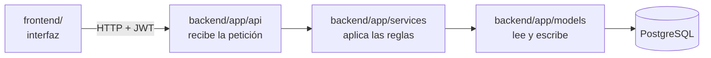
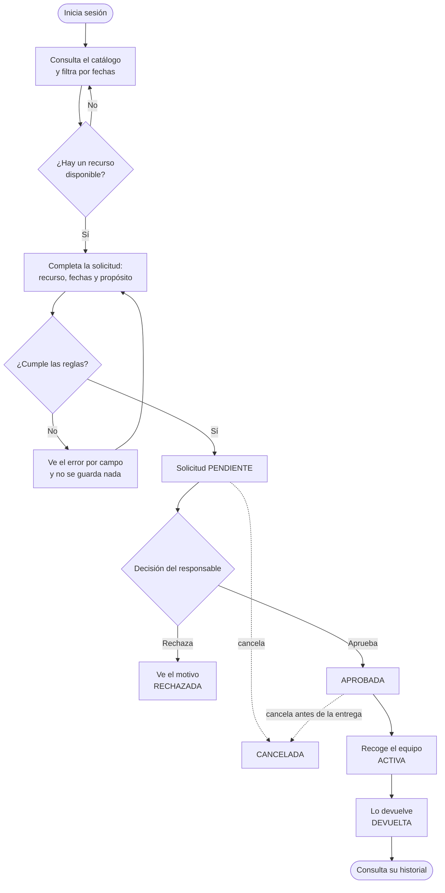
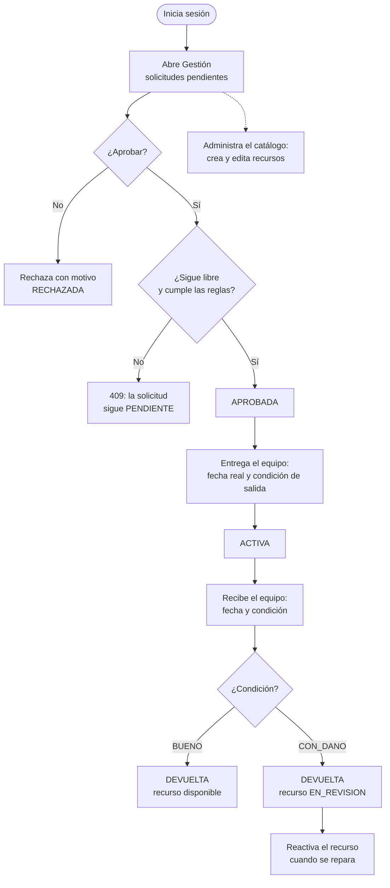
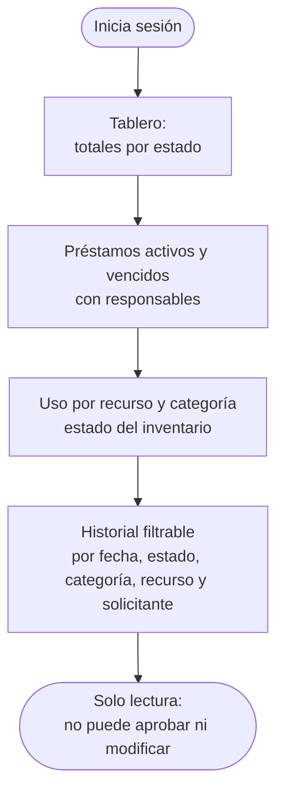
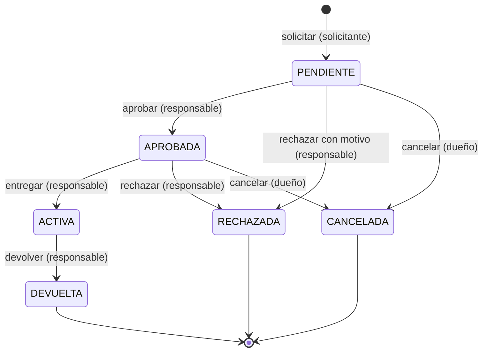
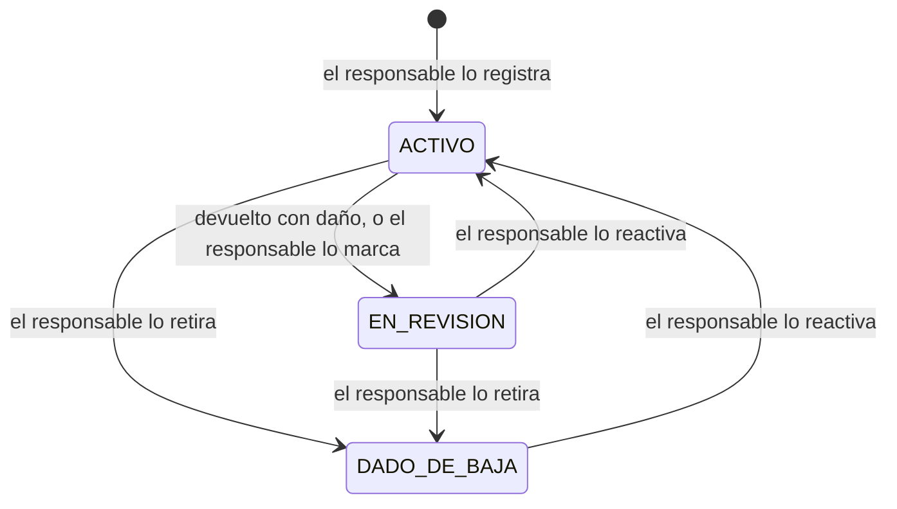

# Explicación del sistema

Guía para entender y exponer el proyecto: cómo está organizado el repositorio, el modelo de base de datos, los
usuarios y el ciclo de vida de cada actor, del préstamo y del recurso. Complementa a
[`diseno.md`](diseno.md) (decisiones técnicas) y a [`requisitos.md`](requisitos.md) (qué se implementa).

## 1. Organización del repositorio

```text
backend/                     API REST (FastAPI + SQLAlchemy + PostgreSQL)
  app/
    api/                     Endpoints: auth, categories, resources, loans, dashboard
    services/                Reglas de negocio: rules, loan_workflow, loans, resources, movements, dashboard
    models/                  Tablas: user, category, resource, loan, movement y enumeraciones
    schemas/                 Formatos de entrada y salida (Pydantic)
    domain/                  Estados del préstamo y transiciones válidas
    security.py · deps.py    Contraseñas (bcrypt), JWT y permisos por rol
    errors.py                Errores uniformes { detail, code, fields }
    seed.py                  Datos ficticios para demostrar y probar
  alembic/versions/          Migración que crea la base de datos
  tests/                     102 pruebas automatizadas (permisos, reglas, flujo)
  scripts/                   verify_a.py y smoke_flow.py (verificación contra PostgreSQL)
  Dockerfile · docker-entrypoint.sh   Imagen y arranque (aplica migraciones y levanta la API)
frontend/src/                Interfaz web (React + TypeScript + Vite)
  pages/                     catalog · requests · review · loans · dashboard
  components/                Piezas compartidas: barra de navegación, modal de recursos, avisos
  auth/ · api/               Sesión y roles · cliente HTTP y tipos
docs/                        requisitos, diseno, trazabilidad, pruebas (PF-01 a PF-14), despliegue, guion
specs/001-prestamos-equipos/ Especificación, plan, tareas y contrato de la API
evidencias/                  Capturas y resultados de las pruebas funcionales
.github/workflows/           ci.yml (pruebas en cada cambio) y deploy.yml (despliegue en Azure)
docker-compose.yml           PostgreSQL y backend para ejecutar en local
```

**Cómo se reparten las responsabilidades** (ver el diagrama de componentes en [`diseno.md`](diseno.md#1-arquitectura-de-componentes)):



- `api/` solo valida el formato y los permisos; no decide reglas.
- `services/` contiene las reglas de negocio (disponibilidad, límites, transiciones).
- `models/` y la base de datos conservan los datos y protegen la integridad.
- La interfaz nunca toca la base de datos: todo pasa por la API.

**Ramas y pull requests:** `main` (protegida: PR, una aprobación y CI en verde; despliega a Azure), `develop`
(integración) y ramas de trabajo por persona o tema (`feat/…`, `docs/…`). Detalle en el
[README](../README.md#8-control-de-versiones).

## 2. Modelo de base de datos

Cinco tablas. El diagrama entidad-relación está en [`diseno.md`](diseno.md#3-modelo-de-datos) y las columnas
completas en [`data-model.md`](../specs/001-prestamos-equipos/data-model.md).

| Tabla | Para qué sirve | Campos y reglas clave |
|---|---|---|
| `users` | Quién usa el sistema | `username` único, `full_name`, `institutional_id` único, `password_hash`, `role`, `requester_type`, `is_active` |
| `categories` | Tipo de recurso | `name` único, `max_loan_hours` (duración máxima de un préstamo) |
| `resources` | Los equipos del inventario | `code` único con formato `PORT-001`, `name`, `description`, `category_id`, `status`, `teacher_only` |
| `loans` | La solicitud y el préstamo, en un solo registro | `resource_id`, `requester_id`, `start_at`, `end_at`, `purpose`, `status`; quién aprobó, entregó y recibió; condición de salida y de devolución; `is_late` |
| `loan_movements` | Historial inmutable de cada cambio de estado | `loan_id`, `actor_id`, `from_status`, `to_status`, `note`, `created_at` |

**Relaciones:** una categoría tiene muchos recursos; un recurso tiene muchos préstamos; un usuario tiene muchos
préstamos (como solicitante, y también como quien aprueba, entrega o recibe); un préstamo tiene muchos movimientos.

**La base de datos protege los datos por sí misma:**

| Protección | Qué impide |
|---|---|
| `loans_no_overlap` (`EXCLUDE USING gist`) | Dos préstamos APROBADA o ACTIVA con periodos solapados del mismo recurso |
| `end_at > start_at` | Periodos al revés |
| Propósito de al menos 10 caracteres | Solicitudes sin justificación |
| Motivo obligatorio si está RECHAZADA | Rechazos sin explicación |
| Fecha de entrega si está ACTIVA o DEVUELTA; fecha y condición de devolución si está DEVUELTA | Préstamos sin datos de entrega o cierre |
| `code` con formato `AAA-000` | Códigos de inventario inválidos |
| Solicitante con `requester_type`; los demás roles, sin él | Usuarios con tipo incoherente |

`VENCIDA` no se guarda: se calcula cuando un préstamo ACTIVO ya pasó su fecha de fin. `loan_movements` es de solo
inserción y los recursos y préstamos no se eliminan.

## 3. Usuarios y roles

Hay tres roles; el solicitante tiene además un tipo.

| Rol | Tipo | Usuario de demostración | Qué puede hacer |
|---|---|---|---|
| SOLICITANTE | ESTUDIANTE | `est.ana`, `est.luis` | Consultar el catálogo, solicitar, cancelar y ver **solo lo suyo**. Límite de 2 operaciones aprobadas o activas |
| SOLICITANTE | DOCENTE | `doc.maria` | Lo mismo, más acceso a recursos «solo docentes». Límite de 5 |
| RESPONSABLE | — | `resp.carlos` | Administrar recursos, aprobar o rechazar, entregar y recibir, ver el tablero |
| COORDINACION | — | `coord.sofia` | Consulta de solo lectura: tablero e historial |

Las contraseñas de demostración no están en el repositorio: se definen al cargar los datos (`python -m app.seed`,
ver el [README](../README.md#5-configuración-del-entorno)). La matriz de permisos por endpoint está en
[`diseno.md`](diseno.md#7-autenticación-permisos-y-seguridad).

## 4. Ciclo de vida de cada actor

Qué hace cada actor desde que entra hasta que termina su trabajo, y qué pasa en el sistema en cada paso.

### 4.1 Solicitante (estudiante o docente)



Reglas que lo condicionan: no puede pedir si tiene un préstamo vencido (RF-13), si alcanzó su límite (RF-14), si el
recurso es «solo docentes» y es estudiante (RF-12) o si el periodo se solapa con otro (RF-15).

### 4.2 Responsable de préstamos



### 4.3 Coordinación



## 5. Ciclo de vida del préstamo

El estado exacto y las acciones permitidas están en [`diseno.md`](diseno.md#4-máquina-de-estados). Resumen:



`VENCIDA` es una vista calculada de `ACTIVA` con fecha de fin pasada; se puede devolver igual. Cada flecha deja un
registro en `loan_movements`.

## 6. Ciclo de vida del recurso

El recurso tiene un **estado operativo** guardado (`ACTIVO`, `EN_REVISION`, `DADO_DE_BAJA`) y una **disponibilidad**
que se calcula según los préstamos.



Mientras está `ACTIVO`, la disponibilidad en un rango de fechas es:

| Situación en ese rango | Se muestra |
|---|---|
| Sin reservas ni préstamos | Disponible |
| Tiene una solicitud APROBADA que se solapa | Reservado |
| Tiene un préstamo ACTIVO o vencido | Prestado |
| `EN_REVISION` o `DADO_DE_BAJA` | No activo |

Un recurso con préstamo activo o vencido **no puede** darse de baja ni pasar a `EN_REVISION` hasta que se devuelva
(RF-35), y un recurso con historial nunca se elimina (RF-36).
