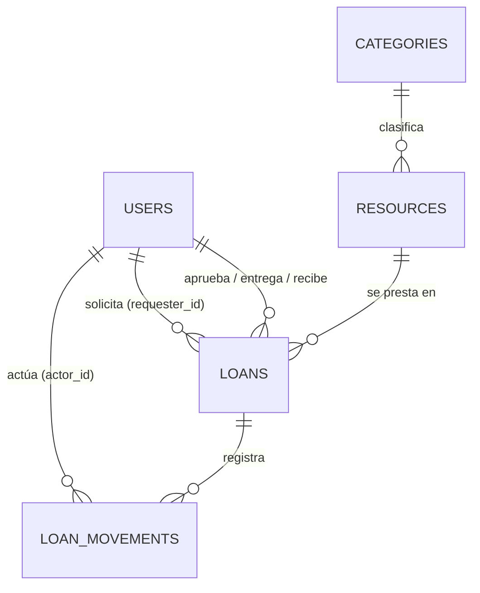
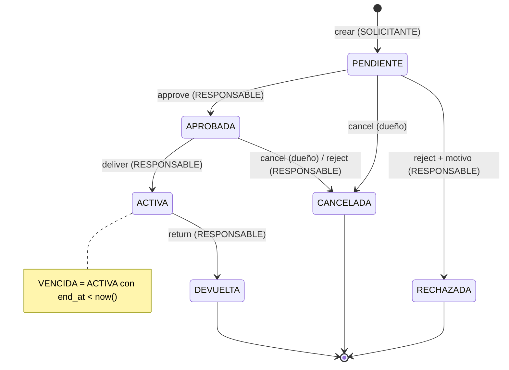

# Data Model — Gestión de préstamos de equipos y recursos

**Feature**: `001-prestamos-equipos` | **Motor**: PostgreSQL 16 | **Responsable de la migración**: Persona B

Convenciones: tablas y columnas en inglés `snake_case`; valores de enumeraciones en español (coinciden
con la spec y la UI); fechas `timestamptz` en UTC, presentadas en `America/Bogota`.

## Diagrama entidad-relación

## Enumeraciones

| Enum | Valores |
|---|---|
| `user_role` | `SOLICITANTE`, `RESPONSABLE`, `COORDINACION` |
| `requester_type` | `ESTUDIANTE`, `DOCENTE` |
| `resource_status` | `ACTIVO`, `EN_REVISION`, `DADO_DE_BAJA` |
| `loan_status` (almacenado) | `PENDIENTE`, `APROBADA`, `RECHAZADA`, `CANCELADA`, `ACTIVA`, `DEVUELTA` |
| `effective_status` (calculado) | los anteriores + `VENCIDA` (= `ACTIVA` y `end_at < now()`) |
| `item_condition` | `BUENO`, `CON_DANO` |

## Tablas

### `users`

| Columna | Tipo | Restricciones |
|---|---|---|
| `id` | serial | PK |
| `username` | varchar(50) | único, no nulo, `^[a-z0-9._]{3,50}$` |
| `full_name` | varchar(120) | no nulo |
| `institutional_id` | varchar(20) | único, no nulo (ficticio) |
| `password_hash` | varchar(255) | no nulo (bcrypt) |
| `role` | `user_role` | no nulo |
| `requester_type` | `requester_type` | nulo salvo SOLICITANTE |
| `is_active` | boolean | default `true` |
| `created_at` | timestamptz | default `now()` |

CHECK: `(role = 'SOLICITANTE') = (requester_type IS NOT NULL)`.

### `categories`

| Columna | Tipo | Restricciones |
|---|---|---|
| `id` | serial | PK |
| `name` | varchar(50) | único, no nulo |
| `max_loan_hours` | integer | no nulo, `> 0` |

Semilla: Portátil 72 h, Cámara 48 h, Instrumento 24 h, Otro 72 h (supuesto de la spec).

### `resources`

| Columna | Tipo | Restricciones |
|---|---|---|
| `id` | serial | PK |
| `code` | varchar(20) | único, no nulo, `^[A-Z]{3,5}-\d{3,4}$` (ej. `PORT-001`) |
| `name` | varchar(120) | no nulo |
| `description` | text | nulo, ≤ 1000 |
| `category_id` | int | FK → `categories.id`, no nulo |
| `status` | `resource_status` | default `ACTIVO` |
| `teacher_only` | boolean | default `false` |
| `created_at`, `updated_at` | timestamptz | default `now()` |

Índices: `category_id`, `status`. Sin borrado físico (FR-036).

### `loans` (solicitud / préstamo)

| Columna | Tipo | Restricciones |
|---|---|---|
| `id` | serial | PK |
| `resource_id` | int | FK → `resources.id`, no nulo |
| `requester_id` | int | FK → `users.id`, no nulo |
| `start_at` | timestamptz | no nulo |
| `end_at` | timestamptz | no nulo, `> start_at` |
| `purpose` | varchar(500) | no nulo, longitud ≥ 10 |
| `status` | `loan_status` | default `PENDIENTE` |
| `rejection_reason` | varchar(500) | requerido si `RECHAZADA` |
| `approved_by_id` / `approved_at` | int FK users / timestamptz | se llenan al aprobar |
| `delivered_by_id` / `delivered_at` | int FK users / timestamptz | se llenan al entregar |
| `checkout_condition` | varchar(500) | requerido al entregar |
| `received_by_id` / `returned_at` | int FK users / timestamptz | se llenan al devolver |
| `return_condition` | `item_condition` | requerido al devolver |
| `return_notes` | varchar(1000) | requerido si `CON_DANO` |
| `is_late` | boolean | default `false`; `returned_at > end_at` |
| `created_at`, `updated_at` | timestamptz | default `now()` |

Restricciones:

- `CHECK (end_at > start_at)`
- `CHECK (status <> 'RECHAZADA' OR rejection_reason IS NOT NULL)`
- `CHECK (status NOT IN ('ACTIVA','DEVUELTA') OR delivered_at IS NOT NULL)`
- `CHECK (status <> 'DEVUELTA' OR (returned_at IS NOT NULL AND return_condition IS NOT NULL))`
- **Exclusión** (requiere `CREATE EXTENSION btree_gist`):
  `EXCLUDE USING gist (resource_id WITH =, tstzrange(start_at, end_at, '[)') WITH &&)
   WHERE (status IN ('APROBADA','ACTIVA'))`

Índices: `(resource_id, status)`, `(requester_id, status)`, `(status, end_at)`, `created_at`.

### `loan_movements` (historial inmutable)

| Columna | Tipo | Restricciones |
|---|---|---|
| `id` | serial | PK |
| `loan_id` | int | FK → `loans.id`, no nulo |
| `actor_id` | int | FK → `users.id`, no nulo |
| `from_status` | `loan_status` | nulo en la creación |
| `to_status` | `loan_status` | no nulo |
| `note` | varchar(1000) | nulo |
| `created_at` | timestamptz | default `now()` |

Solo inserción: los servicios no exponen actualización ni borrado (FR-029). Índice `(loan_id, created_at)`.

## Máquina de estados (`domain/loan_states.py`)

| Acción | Desde | Hacia | Rol | Reglas adicionales |
|---|---|---|---|---|
| `create` | — | PENDIENTE | SOLICITANTE | V1–V7 |
| `approve` | PENDIENTE | APROBADA | RESPONSABLE | `start_at > now()`, V3–V7 revalidadas con bloqueo |
| `reject` | PENDIENTE, APROBADA | RECHAZADA | RESPONSABLE | motivo 5–500 caracteres |
| `cancel` | PENDIENTE, APROBADA | CANCELADA | SOLICITANTE dueño | — |
| `deliver` | APROBADA | ACTIVA | RESPONSABLE | recurso ACTIVO, sin otro ACTIVA del recurso |
| `return` | ACTIVA (incl. VENCIDA) | DEVUELTA | RESPONSABLE | `CON_DANO` ⇒ notas y recurso → EN_REVISION |

Cualquier otra combinación ⇒ `409 INVALID_TRANSITION`.

## Reglas de validación (servicio `services/rules.py`)

| ID | Regla | Error |
|---|---|---|
| V1 | `start_at >= now()`, `end_at > start_at`, propósito 10–500 | 422 `VALIDATION_ERROR` |
| V2 | `end_at - start_at <= category.max_loan_hours` | 422 `VALIDATION_ERROR` |
| V3 | recurso existe y `status = ACTIVO` | 404 / 409 `RESOURCE_NOT_AVAILABLE` |
| V4 | `teacher_only` ⇒ solicitante DOCENTE | 403 `TEACHER_ONLY` |
| V5 | solicitante sin préstamos VENCIDOS | 409 `OVERDUE_BLOCK` |
| V6 | APROBADAS + ACTIVAS del solicitante < límite (ESTUDIANTE 2, DOCENTE 5) | 409 `LIMIT_REACHED` |
| V7 | sin solape con APROBADA/ACTIVA del recurso (ACTIVA vencida ocupa `[start, +∞)`) | 409 `OVERLAP` |

Disponibilidad de un recurso en `[from, to)` = V3 ∧ V7 (las PENDIENTES no bloquean).

## Datos semilla (`backend/app/seed.py`, ficticios)

- Usuarios (contraseña común documentada solo para demo, p. ej. `Demo1234!`):
  `est.ana`, `est.luis` (ESTUDIANTE), `doc.maria` (DOCENTE), `resp.carlos` (RESPONSABLE),
  `coord.sofia` (COORDINACION).
- 4 categorías; ~12 recursos (`PORT-001..004`, `CAM-001..003`, `INST-001..003` con 1 `teacher_only`,
  `OTRO-001..002`), uno EN_REVISION y uno DADO_DE_BAJA.
- Préstamos en todos los estados (incluido uno ACTIVO vencido y dos PENDIENTES solapadas) con sus
  movimientos, para demostrar CA-01…CA-06 desde el primer arranque.
