# Implementation Plan: Gestión de préstamos de equipos y recursos

**Branch**: `001-prestamos-equipos` | **Date**: 2026-11-16 | **Spec**: [spec.md](spec.md)

**Input**: Feature specification from `specs/001-prestamos-equipos/spec.md`

## Summary

Aplicación web cliente-servidor para el ciclo completo de préstamo de equipos (catálogo →
solicitud → evaluación → entrega → devolución → historial y tablero), cumpliendo CA-01…CA-06 de la
guía PF-03. SPA React que consume una API REST FastAPI sobre PostgreSQL. Las reglas de negocio se
aplican en servicios del backend; la incompatibilidad de asignaciones se garantiza con bloqueo de
filas y una restricción de exclusión de rangos en PostgreSQL ([research R3](research.md)). El trabajo
se divide entre **dos personas por historias de usuario full-stack**, tras una fundación compartida
y un contrato de API aprobado por ambos.

## Technical Context

**Language/Version**: Python 3.12 (backend), TypeScript 5 + Node.js ≥ 20 (frontend)

**Primary Dependencies**: FastAPI, Pydantic v2, SQLAlchemy 2, Alembic, psycopg 3, PyJWT,
passlib[bcrypt], pydantic-settings · React 18, Vite, React Router 6, TanStack Query 5

**Storage**: PostgreSQL 16 (extensión `btree_gist`)

**Testing**: Pruebas funcionales documentadas (Swagger UI + colección `.http`) como entregable;
`pytest` + `httpx/TestClient` opcional para reglas críticas

**Target Platform**: Ejecución local en Windows/Linux; navegador de escritorio moderno

**Project Type**: Aplicación web (frontend + backend)

**Performance Goals**: Catálogo y tablero < 2 s con 200 recursos y 2.000 operaciones (SC-008)

**Constraints**: Sin Docker obligatorio ni nube; sin secretos en el repo; Windows con App Control
(usar `python -m ...`)

**Scale/Scope**: ~5–50 usuarios de demo, 3 roles, ~10 pantallas, 18 endpoints

## Constitution Check

*GATE: Must pass before Phase 0 research. Re-check after Phase 1 design.*

| Principio | Cumplimiento en el diseño | Estado |
|---|---|---|
| I. Ciclo completo | 7 historias cubren CA-01…CA-06; préstamos sin DELETE, solo transiciones | ✅ |
| II. Reglas en servidor / atomicidad | `services/rules.py` + `FOR UPDATE` + `EXCLUDE USING gist`; máquina de estados explícita; movimientos en la misma transacción | ✅ |
| III. Seguridad por rol | JWT + bcrypt; `require_roles` por endpoint; filtro de propiedad en servicios; `.env.example`; errores sin trazas | ✅ |
| IV. API REST documentada | [contracts/api.md](contracts/api.md) + OpenAPI `/docs`; formato de error uniforme; códigos 401/403/404/409/422 | ✅ |
| V. Pruebas verificables | PF-01…PF-12 asignadas por persona; `evidencias/`; colección `.http` | ✅ |
| VI. Trazabilidad / Git | Ramas por historia, PR con revisión cruzada obligatoria, plantilla de PR, `docs/trazabilidad.md` | ✅ |
| VII. Simplicidad | Sesiones síncronas, sin repository pattern, sin librería UI pesada, VENCIDA calculada sin jobs | ✅ |

**Re-check post-diseño (Fase 1)**: sin violaciones; no se requiere Complexity Tracking.

## Project Structure

### Documentation (this feature)

```text
specs/001-prestamos-equipos/
├── plan.md              # Este archivo
├── research.md          # Decisiones técnicas (Fase 0)
├── data-model.md        # Entidades, estados, reglas (Fase 1)
├── quickstart.md        # Guía de ejecución y validación (Fase 1)
├── contracts/api.md     # Contrato REST acordado (Fase 1)
├── checklists/          # Calidad de la spec
└── tasks.md             # Fase 2 (/speckit-tasks)
```

### Source Code (repository root)

```text
backend/
├── requirements.txt
├── .env.example
├── alembic.ini
├── alembic/versions/            # [B] migración inicial
├── app/
│   ├── main.py                  # [A] app, CORS, routers, health
│   ├── config.py                # [A] settings (.env)
│   ├── database.py              # [B] engine, SessionLocal, get_db
│   ├── errors.py                # [A] AppError + handlers (formato uniforme)
│   ├── security.py              # [A] hash, JWT
│   ├── deps.py                  # [A] get_current_user, require_roles
│   ├── seed.py                  # [B] datos ficticios
│   ├── models/                  # [B] user, category, resource, loan, movement
│   ├── schemas/                 # [A] auth, resource, loan(create)  · [B] loan(actions), movement
│   ├── domain/loan_states.py    # [B] transiciones permitidas
│   ├── services/
│   │   ├── rules.py             # [B] V1–V7, overlap, límites (compartido)
│   │   ├── movements.py         # [B] registrar movimiento
│   │   ├── resources.py         # [A] catálogo, disponibilidad, CRUD recurso
│   │   ├── loans.py             # [A] crear, listar, detalle, cancelar
│   │   ├── loan_workflow.py     # [B] aprobar, rechazar, entregar, devolver
│   │   └── dashboard.py         # [A] resumen y uso
│   └── api/
│       ├── auth.py              # [A]
│       ├── categories.py        # [A]
│       ├── resources.py         # [A]
│       ├── loans.py             # [A] POST/GET/cancel  · [B] approve/reject/deliver/return/movements
│       └── dashboard.py         # [A]
└── tests/                       # opcional: test_rules.py [B], test_permissions.py [A]

frontend/
├── package.json
├── .env.example
└── src/
    ├── main.tsx, App.tsx        # [B] router + layout
    ├── api/client.ts            # [A] fetch + token + errores
    ├── api/types.ts             # [A+B] tipos del contrato (revisión conjunta)
    ├── auth/                    # [A] AuthContext, LoginPage, ProtectedRoute
    ├── components/              # [B] Layout/NavBar por rol, StatusBadge, ErrorAlert, DataTable, DateTimeField, ConfirmDialog
    └── pages/
        ├── catalog/             # [A] CatalogPage, ResourceDetailPage
        ├── resources/           # [A] ResourceFormPage (admin)
        ├── requests/            # [A] NewRequestPage, MyRequestsPage
        ├── review/              # [B] ReviewInboxPage (bandeja /gestion)
        ├── loans/               # [B] LoanDetailPage + historial de movimientos
        └── dashboard/           # [A] DashboardPage, HistoryPage

docs/            requisitos.md [B] · diseno.md [B] · trazabilidad.md [B, filas de A y B en sus PR] · pruebas.md [A+B] · pruebas/prestamos.http
evidencias/      PF-01…PF-12 (capturas por prueba)
README.md        [A, con aportes de B]
```

**Structure Decision**: Monorepo con `backend/` y `frontend/` (opción aplicación web). Las capas
`api/ → services/ → models/` del backend separan HTTP, reglas y persistencia y permiten que cada
persona trabaje en archivos distintos; los únicos archivos compartidos (`api/loans.py`,
`schemas/loan.py`, `api/types.ts`) se dividen por secciones y se integran por PR.

## Reparto de trabajo (2 personas, full-stack por historias)

### Responsabilidades

| Persona | Fundación | Historias | Pruebas guía | Documentos |
|---|---|---|---|---|
| **A — Santiago** | Esqueleto backend (`main`, `config`, `errors`), autenticación JWT/roles (back + front: cliente API, AuthContext, login, rutas protegidas), `LoanOut` y lectura de préstamos (`GET /loans`, `GET /loans/{id}`) | **US1** Catálogo/disponibilidad (CA-01) · **US2** Solicitudes (CA-02, incluye `GET /loans/{id}/movements` y `MovementTimeline`) · **US7** Administración de recursos · **US6** Tablero coordinación (CA-06) | PF-01, 02, 03, 04, 11 | README |
| **B — Persona B** | Modelos + migración (incl. exclusión) + semillas, máquina de estados, `rules.py`, `movements.py`; layout frontend (router, NavBar por rol, componentes compartidos) | **US3** Evaluación (CA-03) · **US4** Entrega/préstamo activo (CA-04) · **US5** Devolución e historial (CA-05) | PF-05, 06, 07, 08, 09, 10 | `docs/diseno.md` (diagramas, modelo, API) |
| **Ambos** | Revisar y aprobar `contracts/api.md` + `api/types.ts` | Integración final | **PF-12** flujo integral (A solicita, B gestiona) | `docs/trazabilidad.md`, `docs/pruebas.md`, `evidencias/` |

Carga aproximada: A = 4 historias de complejidad baja-media; B = 3 historias de complejidad alta
(transiciones concurrentes) + la capa de datos. Balance similar en esfuerzo.

### Fases y dependencias

```mermaid
gantt
    dateFormat  X
    axisFormat  F%s
    section Ambos
    F0 Contrato API + repo + plantilla PR      :f0, 0, 1
    section Persona A
    F1A Esqueleto + Auth (back/front)           :a1, after f0, 2
    US1 Catálogo                                :a2, after a1, 2
    US2 Solicitudes                             :a3, after a2, 2
    US7 Admin recursos                          :a4, after a3, 1
    US6 Tablero                                 :a5, after a4, 2
    section Persona B
    F1B Modelos + migración + seed + layout     :b1, after f0, 2
    US3 Evaluación                              :b2, after b1, 2
    US4 Entrega                                 :b3, after b2, 2
    US5 Devolución + historial                  :b4, after b3, 2
    section Ambos
    Integración + PF-12 + docs                  :z, after a5, 2
```



1. **F0 – Acuerdo (ambos, bloqueante)**: merge de la spec/plan a `main`, crear repo GitHub, proteger
   `main`, plantilla de PR, aprobar [contracts/api.md](contracts/api.md).
2. **F1 – Fundación (en paralelo)**: F1A y F1B son independientes (A no toca modelos; B no toca auth).
   Punto de sincronización: **ambos PR de fundación mergeados** antes de iniciar historias.
3. **Historias (en paralelo)**:
   - B no depende de US2 de A: trabaja US3–US5 sobre las solicitudes **semilla** (PENDIENTES,
     APROBADAS, ACTIVAS, VENCIDA).
   - A usa `rules.py` de B (fundación) en US1 (disponibilidad) y US2 (crear solicitud).
   - US6 (A) consulta estados producidos por US3–US5; puede desarrollarse con datos semilla.
4. **Integración**: PF-12 conjunta, trazabilidad, README y evidencias.

### Contratos internos entre personas (acordar en F0)

| Interfaz | Proveedor | Consumidor | Firma |
|---|---|---|---|
| `get_current_user`, `require_roles(*roles)` | A | B | dependencias FastAPI → `User` |
| `AppError(status, code, detail, fields=None)` | A | B | excepción → formato uniforme |
| `apiFetch<T>(path, opts)`, `useAuth()` | A | B | cliente front + contexto de sesión |
| Modelos SQLAlchemy y `get_db` | B | A | según [data-model.md](data-model.md) |
| `rules.check_can_request(db, user, resource, start, end)` | B | A | lanza `AppError` V1–V7 |
| `rules.find_overlaps(db, resource_id, start, end)` / `is_available(...)` | B | A | lista de préstamos / bool |
| `movements.record(db, loan, actor, from_status, to_status, note)` | B | A (crear/cancelar) | inserta `LoanMovement` |
| `loan_states.assert_transition(loan, action, user)` | B | A (cancelar) | lanza `INVALID_TRANSITION` |
| `<Layout>`, `<StatusBadge>`, `<ErrorAlert>`, `<DataTable>` | B | A | componentes React |
| `LoanOut` (schema de salida de `Loan`), `GET /loans`, `GET /loans/{id}` | A (en F1A) | B | según contrato; B los usa desde US3 |
| `GET /loans/{id}/movements`, `<MovementTimeline>` | A (en US2) | B (US5) | según contrato |

## Flujo Git y pull requests

- `main` protegido: solo se integra por PR con **1 aprobación del otro integrante**.
- Una rama por unidad de trabajo, desde `main` actualizado:
  `feat/f1a-auth`, `feat/f1b-datos`, `feat/us1-catalogo`, `feat/us7-recursos`, `feat/us2-solicitudes`,
  `feat/us6-tablero`, `feat/us3-evaluacion`, `feat/us4-entrega`, `feat/us5-devolucion`,
  `docs/...`, `fix/...`.
- Commits pequeños en español estilo Conventional Commits con referencia de requisito, p. ej.
  `feat(loans): valida solapamiento al aprobar (FR-020, CA-03)`.
- Plantilla `.github/pull_request_template.md`: propósito · cambios · requisitos (RF/CA) · pruebas
  efectuadas (PF-XX + evidencia) · checklist de constitución.
- Revisión cruzada: A revisa los PR de B y viceversa, dejando al menos un comentario sustantivo
  (evidencia de revisión que pide la guía).
- Cada PR de historia actualiza su fila en `docs/trazabilidad.md` y sus pruebas en `docs/pruebas.md`.

## Mapeo a los entregables de la guía

| Entregable guía | Fuente Spec Kit | Responsable |
|---|---|---|
| `docs/requisitos.md` (Act. 2) | `spec.md` (US, FR→RF-XX, supuestos) + registro de entrevista | B |
| `docs/diseno.md` (Act. 3) | `plan.md`, `research.md`, `data-model.md`, `contracts/api.md`, prototipos | B |
| Código + BD (Act. 4) | `tasks.md` | A y B |
| Git/GitHub (Act. 5) | Flujo de ramas/PR de este plan | A y B |
| Pruebas PF-01…12 (Act. 6) | `quickstart.md` + `docs/pruebas.md` + `evidencias/` | A y B (según tabla) |
| `docs/trazabilidad.md` (Act. 7) | CA → US → FR → archivos → PR → PF | A y B |
| `README.md` (informe) | Secciones 1–9 de la guía | A (B aporta secciones 4 y 6) |

Equivalencia de identificadores: `FR-0NN` de la spec = `RF-NN` en `docs/requisitos.md`.

## Complexity Tracking

No aplica: el Constitution Check no presenta violaciones.
